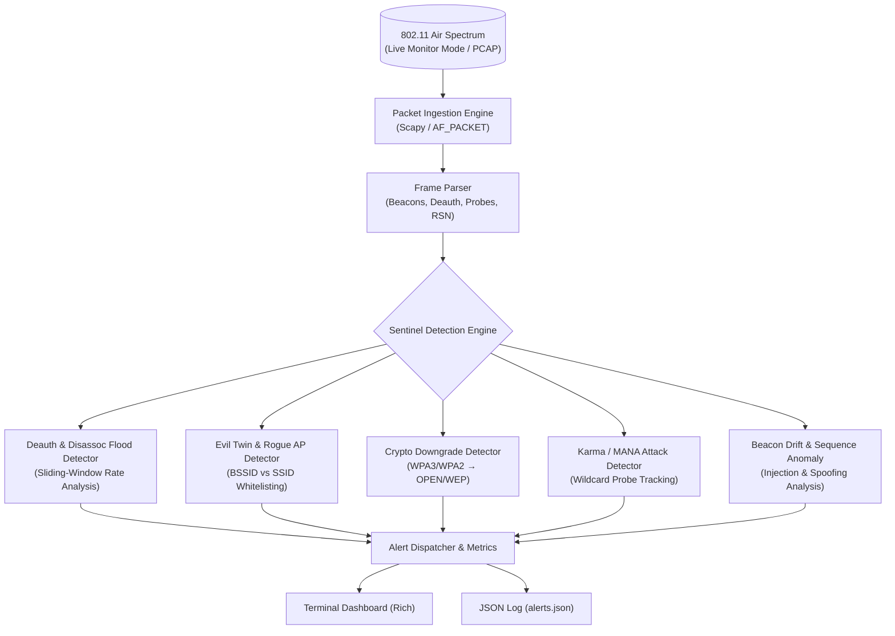

# WIDS-Sentinel

[](https://github.com/0xlazorr/wids-sentinel/actions/workflows/ci.yml)
[](https://python.org)
[](LICENSE)
[](https://github.com/psf/black)

A high-throughput, modular **802.11 Wireless Intrusion Detection System (WIDS)** engineered for blue teams, threat hunters, and wireless penetration testers. 

**WIDS-Sentinel** inspects raw 802.11 management frames in real time (or via offline PCAP replays) to detect active rogue access points, Evil Twin attacks, deauthentication flood denial-of-service, encryption downgrades, and Karma/MANA rogue AP behaviors.

---

## Architecture & Detection Pipeline



---

## Detection Capabilities & Rule Catalog

| Rule ID | Rule Name | Severity | Attack Vector Detected |
|---|---|---|---|
| `WIDS-RULE-001` | **DEAUTH_FLOOD** | `CRITICAL` / `HIGH` | High-frequency 802.11 deauthentication/disassociation burst attacks targeting single stations or broadcast (`ff:ff:ff:ff:ff:ff`). |
| `WIDS-RULE-002` | **EVIL_TWIN_ROGUE_AP** | `CRITICAL` | Rogue access points broadcasting authorized SSIDs with unauthorized BSSIDs (MACs). |
| `WIDS-RULE-003` | **CRYPTO_DOWNGRADE** | `CRITICAL` | An AP configured for WPA2/WPA3 broadcasting as an unencrypted (OPEN) or WEP network to lure credentials. |
| `WIDS-RULE-004` | **CHANNEL_MISMATCH** | `MEDIUM` | Authorized APs operating outside of their assigned frequency channels. |
| `WIDS-RULE-005` | **KARMA_MANA_ATTACK** | `CRITICAL` | Single rogue BSSID responding to probe requests for multiple arbitrary SSIDs (e.g., WiFi Pineapple attacks). |
| `WIDS-RULE-006` | **MALFORMED_BSSID** | `HIGH` | Transmitters broadcasting beacons with invalid MAC addresses (e.g., multicast bit set on BSSID). |
| `WIDS-RULE-007` | **BEACON_SEQ_ANOMALY** | `MEDIUM` | Abrupt sequence number leaps (> 200 within 0.5s), indicating frame injection or multi-transmitter contention. |

---

## Features

- **Live & Offline Analysis:** Sniffs wireless interfaces in monitor mode (`wlan0mon`) or analyzes captured PCAP/PCAPNG files offline.
- **Hardware-Free Testing:** Includes a synthetic attack generator script and sample PCAP (`data/demo_attacks.pcap`) for automated testing and CI.
- **Sliding-Window Rate Limiting:** Avoids alert flooding during massive denial-of-service deauthentication attacks.
- **Rich Terminal UI:** Color-coded severity badges with actionable defense and mitigation guidance for each alert.
- **Machine-Readable Outputs:** Structured JSON alert logs (`alerts.json`) compatible with SIEM ingestion (Elasticsearch, Splunk, Wazuh).

---

## Quick Start

### 1. Installation

Clone the repository and install dependencies:

```bash
git clone https://github.com/0xlazorr/wids-sentinel.git
cd wids-sentinel

# Install package in editable mode
pip install -e .

# Or install dev dependencies for running tests
pip install -e ".[dev]"
```

### 2. Run Instant Offline Demo (No Wi-Fi Card Needed)

Run WIDS-Sentinel against the bundled sample attack capture:

```bash
wids-sentinel -r data/demo_attacks.pcap -c data/sample_authorized_aps.json
```

### 3. Live Monitoring on Wireless Interface

Put your wireless interface into monitor mode and start real-time spectrum defense:

```bash
# Enable monitor mode
sudo ip link set wlan0 down
sudo iw dev wlan0 set type monitor
sudo ip link set wlan0 up

# Launch WIDS-Sentinel
sudo wids-sentinel -i wlan0 -c data/sample_authorized_aps.json -o /var/log/wids_alerts.json
```

---

## Configuration

Define your authorized network infrastructure in a simple JSON profile:

```json
{
  "authorized_aps": [
    {
      "ssid": "Corp_Secure_WiFi",
      "bssid": "00:11:22:33:44:55",
      "channel": 6,
      "expected_crypto": "WPA2"
    }
  ],
  "deauth_threshold_burst": 8,
  "deauth_window_seconds": 2.0,
  "enable_deauth_detection": true,
  "enable_evil_twin_detection": true,
  "enable_karma_detection": true,
  "enable_beacon_drift_detection": true,
  "alert_log_file": "alerts.json"
}
```

You can also pass authorized networks directly via the CLI:
```bash
wids-sentinel -r capture.pcap --auth-ssid "OfficeNet" --auth-bssid "00:aa:bb:cc:dd:ee" --auth-channel 1 --auth-crypto WPA3
```

---

## Running the Test Suite

WIDS-Sentinel has comprehensive unit and integration test coverage:

```bash
pytest -v --cov=wids
```

Generate synthetic attack scenarios on demand:
```bash
python scripts/generate_sample_pcap.py custom_test.pcap
```

---

## Defensive Recommendations & Countermeasures

1. **Enforce 802.11w (PMF / Management Frame Protection):**
   - Configures cryptographic signatures on management frames (Deauth/Disassoc). Prevents unauthenticated adversaries from spoofing disconnection frames.
2. **Transition to WPA3-Enterprise:**
   - WPA3 mandates Protected Management Frames and eliminates offline dictionary cracking via Simultaneous Authentication of Equals (SAE).
3. **802.1X Certificate-Based Authentication (EAP-TLS):**
   - Renders Evil Twin captive portals ineffective by authenticating both the client and the RADIUS server using trusted PKI certificates.
4. **Disable Wi-Fi Auto-Probe on Endpoints:**
   - Prevents endpoints from broadcasting probe requests for remembered networks in public spaces, neutralising Karma/MANA attacks.

---

## License

This project is licensed under the [MIT License](LICENSE).

---

## Author

**lazorr** ([@0xlazorr](https://github.com/0xlazorr))  
Offensive Security Engineer &bull; Red Teamer &bull; Network &amp; Systems Security  
Website: [Portfolio](https://github.com/0xlazorr/MyPortfolio)
